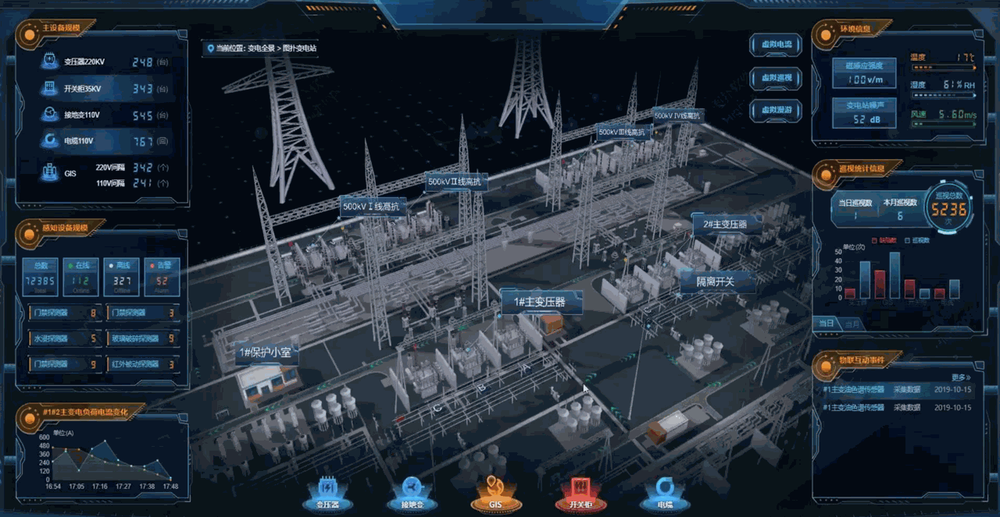
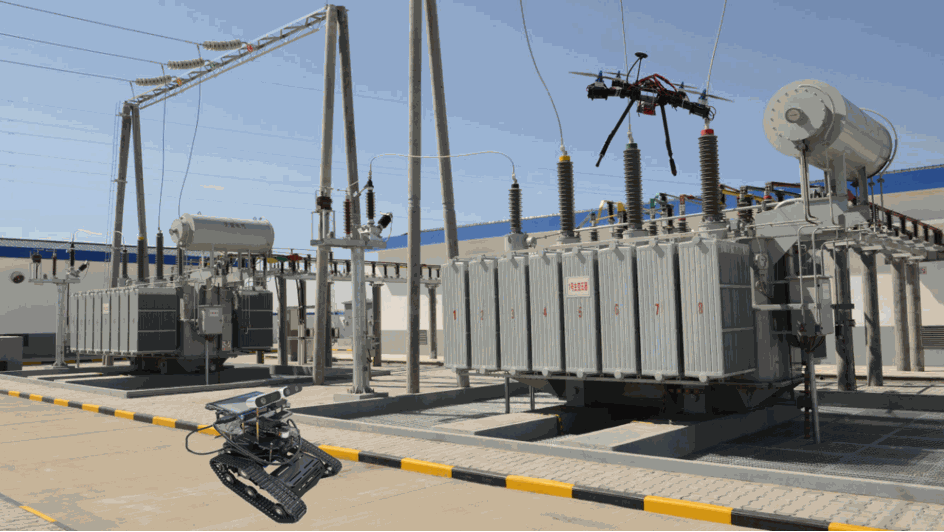
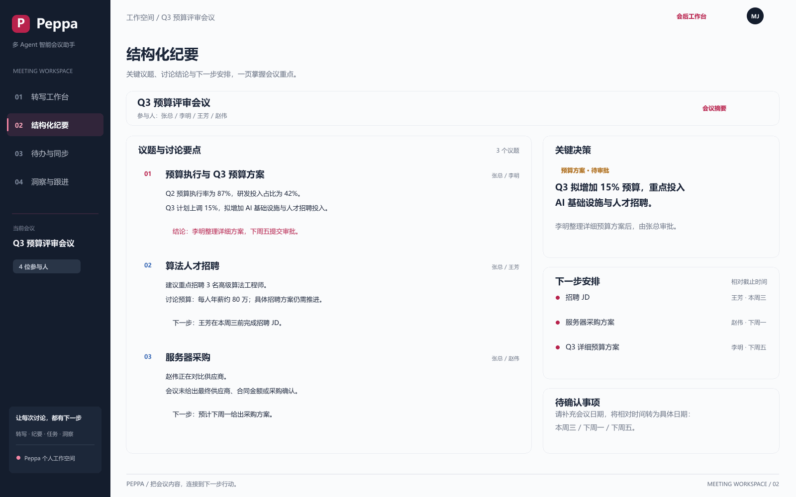
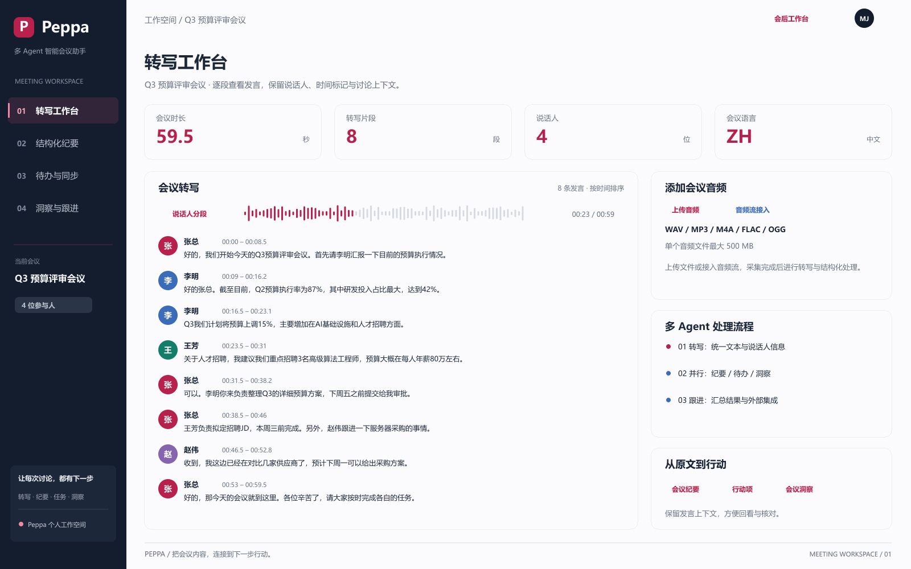
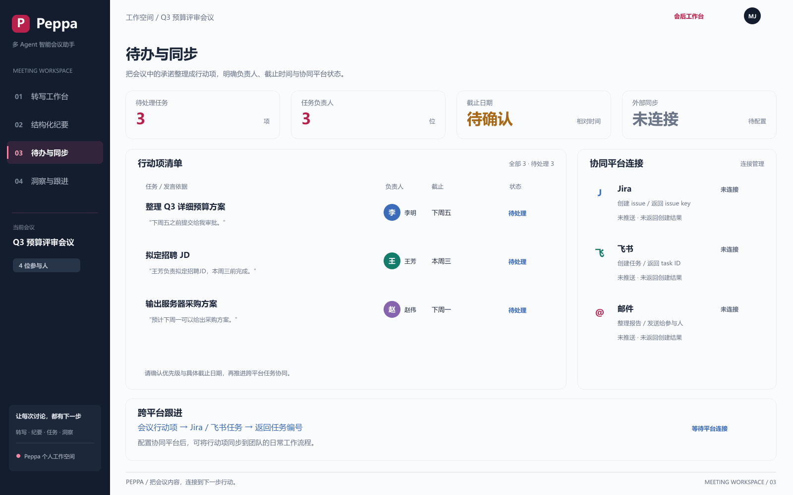
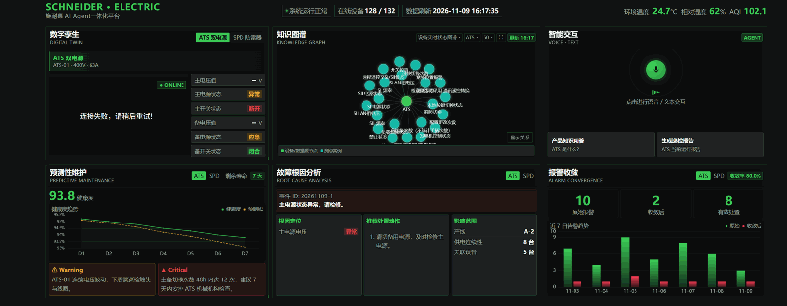

# Ma Jing · 马靖

### AI Product · Industrial AI · Digital Twins

把复杂技术，变成可用的产品。  
Turning complex technology into usable products.

[数字孪生与工业组态 / Digital Twin Lab](https://github.com/MjCharles2002/Digital-Twin-Lab-)

## 关于我 / About

关注 AI Agent、工业智能与数字孪生，连接产品设计、算法理解与工程实现。通过场景分析、产品原型与本地 Demo，把技术能力组织成可理解、可验证的工作流程。

I explore AI agents, industrial intelligence and digital twins, connecting product design with algorithmic understanding and implementation through workflows, prototypes and local demos.

**展示方式：本仓库以项目介绍和界面截图呈现作品，Demo 在本地运行，不提供在线体验服务。**  
**This is a screenshot-based portfolio. Demos run locally; no live service is provided.**

## 精选项目 / Selected projects

| 项目 / Project | 关注问题 / Focus | 我的参与 / Contribution |
| --- | --- | --- |
| 数字孪生智慧电网运检 / Digital-twin inspection | 现场信息、设备状态与巡检流程整合 | 总体方案、功能规划与项目推进 |
| Peppa 智能会议助手 / Meeting assistant | 会议内容如何转化为可跟进的行动 | 功能规划、Agent 协作方案与原型开发 |
| 设备 AI 问答与智能运维 / Equipment Q&A | 从设备状态到问题理解与辅助处置 | 主要功能开发、交互优化与前后端联调 |
| 工业 AI 工艺优化 / Process optimization | 质量预测、软测量与能源协同 | 算法路线细化与数据集成规划 |

## 01 · 数字孪生智慧电网运检

### Digital-twin inspection

将三维站区、设备信息与巡检数据放进同一视图，帮助使用者理解设备位置、运行状态和异常信息。我的参与覆盖总体方案、功能规划，以及高压开关状态检测相关研究。

A unified view of the station, equipment and inspection information. My contributions cover solution planning, feature definition and research related to high-voltage switch-state detection.

*界面展示：三维站区、设备信息与状态面板。 / Station overview, equipment information and status panels.*

查看更多场景图片 / More scene images

## 02 · Peppa 智能会议助手

### Multi-agent meeting assistant

从音频转写出发，生成结构化纪要、提取待办并组织会议洞察。方案采用“转写 → 摘要、待办与洞察并行处理 → 汇总跟进”的流程，结合结构化校验与异常降级。

A meeting workflow that turns transcription into structured summaries, action items and insights. Transcription feeds parallel analysis steps, followed by validation and consolidated follow-up.

**我的职责：** 功能规划、协作方案与原型开发。Jira、飞书相关工作为接口设计与代码接入，不表示已上线服务。

**My role:** feature planning, agent workflow design and prototyping. Jira and Feishu work covers interface design and code integration, rather than a deployed service.

*界面展示：议题、关键决策与下一步安排。示例会议内容用于演示。 / Topics, decisions and next steps using sample meeting content.*

转写与任务跟进 / Transcription and action items

## 03 · 设备 AI 问答与智能运维

### Equipment Q&A and intelligent operations

围绕“查看状态 → 理解问题 → 辅助处置”组织问答、预测维护、故障根因分析与报警收敛，重点处理设备上下文、工具调用和结果呈现之间的衔接。

An operations workflow connecting equipment context, Q&A, maintenance trends, root-cause analysis and alarm consolidation.

**我的职责：** 深度参与主要功能模块开发、交互优化与联调；知识图谱少量参与，三维建模未参与。

**My role:** major feature development, interaction refinement and integration. Limited knowledge-graph contribution; no contribution to the 3D modeling.

*界面截图：智能交互、维护趋势、根因分析与报警区域；画面数据用于界面展示。 / Interface showing interaction, maintenance, diagnosis and alarm panels.*

## 04 · 工业 AI 工艺优化方案

### Industrial AI solution planning

围绕间歇蒸煮场景，将质量与能耗问题拆解为质量预测、残碱软测量和能源协同优化，明确数据输入、模型输出、验证路径与业务使用方式。

Solution planning for batch cooking processes: quality prediction, residual-alkali soft sensing and coordinated energy optimization, with explicit data inputs, model outputs and validation steps.

**参与内容：** 算法路线细化、数据集成规划与方案设计。此项目以方案规划为主。

## 我的工作方式 / How I work

**Discover → Design → Validate**

- **理解问题：** 用户任务、业务约束与交付边界。 / Frame needs, constraints and scope.
- **设计方案：** 将模型能力组织成可用流程。 / Translate capabilities into usable workflows.
- **验证体验：** 用原型与本地演示检查关键交互。 / Validate interactions with local prototypes.

## 更多作品 / More work

[Digital Twin Lab — 三维场景、设备拆解与工业组态截图](https://github.com/MjCharles2002/Digital-Twin-Lab-)

本仓库展示文档和图片，项目程序保留本地。截图及项目材料不附带第三方素材的再授权。  
This repository contains documentation and images; project applications remain local. Screenshots do not grant additional rights to third-party materials.
